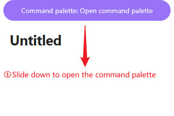
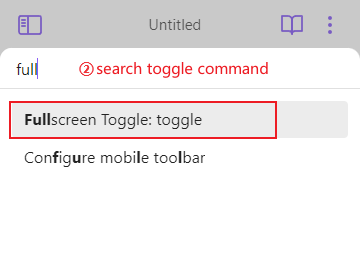

# Fullscreen Toggle

Fullscreen focus across all platforms. It helps you get more display space when you focus on reading notes, especially on mobile devices.

**usage**

- Shortcuts: double click/touch to toggle fullscreen (or triple by settings).
- Command: Full screen (It is recommended to use the mobile end, and an example is provided below).
- Command or hotkey only:  When you feel that mouse clicks will accidentally trigger Fullscreen, you can enable using only commands and shortcut keys through settings. Special thanks for [Aleksey Rowan](https://github.com/aleksey-rowan)'s contribution.
- Also enter system fullscreen (desktop): when enabled in settings, toggling fullscreen on also puts the Obsidian window into system fullscreen, and toggling off restores it. If the window was already in system fullscreen, only the Obsidian interface is toggled and the window stays fullscreen.

***

**Contact me**

- email: donkeypacific@outlook.com

